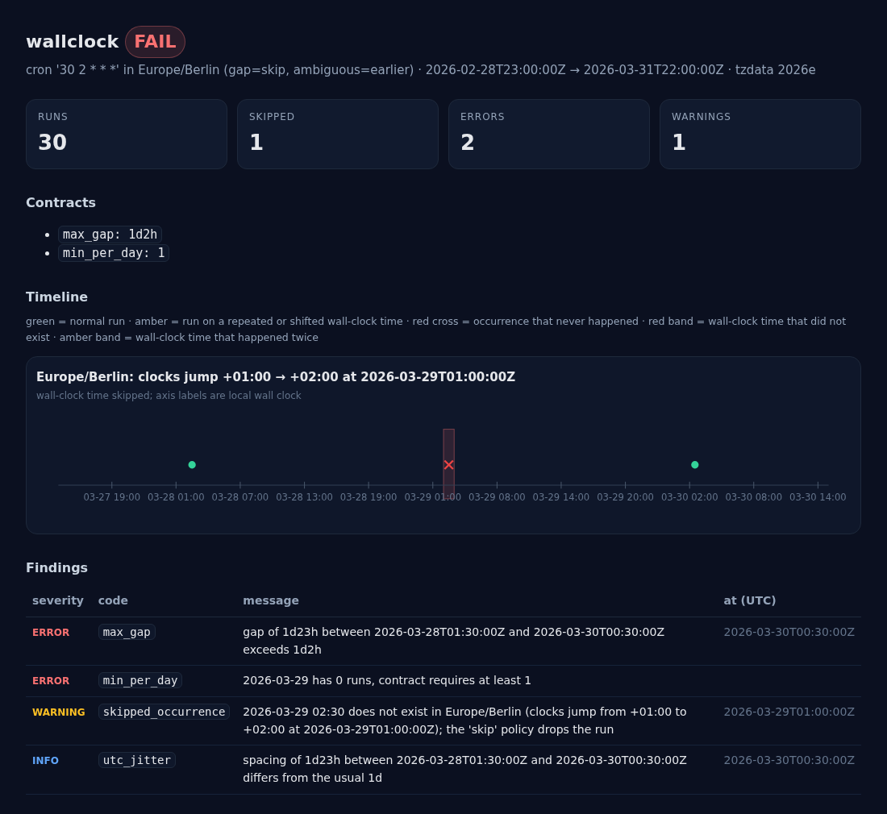

# wallclock

**Temporal-contract verification for scheduled jobs.**

A cron line or an RRULE is a sentence about *wall-clock* time. The wall clock is
not a function: every year, in most of the world, one local hour does not exist
and another happens twice. A few timezones have moved the date line outright.
Your scheduler does something in those moments — and nobody checks what.

`wallclock` simulates a schedule exactly, then *exhaustively* checks contracts
such as "never more than 26 hours between runs" or "every run happens between
08:00 and 10:00 local", over a window you choose. Every violation comes with the
instant that proves it. Repairs are re-verified by the same checker.

```console
$ wallclock check --cron '30 2 * * *' --tz Europe/Berlin \
    --from 2026-03-01 --to 2026-04-01 --max-gap 26h --min-per-day 1
wallclock - temporal contract verification
schedule : cron '30 2 * * *' in Europe/Berlin (gap=skip, ambiguous=earlier)
window   : 2026-02-28T23:00:00Z .. 2026-03-31T22:00:00Z (30d23h), tzdata 2026e
runs     : 30 in window, 1 wall-clock occurrence(s) skipped
clocks   : 2026-03-29 03:00 local +01:00->+02:00 (2026-03-29T01:00:00Z)
verdict  : FAIL (2 error(s), 1 warning(s))
contracts: max_gap: 1d2h; min_per_day: 1

--- ERROR (2) ---
max_gap [2026-03-30T00:30:00Z]: gap of 1d23h between 2026-03-28T01:30:00Z and 2026-03-30T00:30:00Z exceeds 1d2h
min_per_day: 2026-03-29 has 0 runs, contract requires at least 1

--- WARNING (1) ---
skipped_occurrence [2026-03-29T01:00:00Z]: 2026-03-29 02:30 does not exist in Europe/Berlin (clocks jump from +01:00 to +02:00 at 2026-03-29T01:00:00Z); the 'skip' policy drops the run
```

That is the most ordinary cron in Europe. Once a year it does not run, and the
next run is 47 hours later — which is why "daily" backups turn out to be
"25 hours of staleness, twice a year".



## The seven silent failures in `wallclock demo`

| case | what happens | day job dies |
| --- | --- | --- |
| Berlin `30 2 * * *` | 02:30 does not exist on the spring-forward Sunday | 47-hour hole |
| Santiago `0 0 * * *` | clocks move **at midnight**, so the midnight run disappears | one day with no backup |
| Lord Howe `15 2 * * *` | DST is a **30-minute** shift: 02:00 → 02:30 | 02:15 vanishes |
| Samoa, 2011-12-30 | the date line moved; the whole day was skipped | a yearly Dec-30 job loses a year |
| Feb 29 yearly | 2096 → 2104 is an **8-year** gap (2100 is not a leap year) | "yearly" freshness is a lie |
| Berlin, `ambiguous=both` | the repeated autumn hour runs the job **twice** | double billing / double send |
| cron `0 0 1 * 1` | day-of-month **OR** day-of-week | 13 unintended runs a year |

`python3 -m wallclock demo --out demo` writes the HTML tour (one page per case,
plus an `.ics` of the first case).

## Install

Python 3.11+ and a system tz database. No runtime dependencies.

```bash
python3 -m pip install -e .        # or: PYTHONPATH=. python3 -m wallclock ...
wallclock demo
```

Optional, for the differential test suite only: `python-dateutil`, `croniter`
(`python3 -m pip install -e '.[test]'`).

## Contracts

| contract | example | meaning |
| --- | --- | --- |
| `max_gap` | `26h` | no two consecutive runs are further apart than this |
| `local_window` | `08:00-10:00` | every run's **effective** local time-of-day is inside the window |
| `min_per_day` | `1` | every fully covered local date has at least N runs |
| `max_per_day` | `1` | ... and at most N |
| `max_drift` | `0s` | a run may not land further than this from the wall clock it asked for |

Durations accept `30s`, `90m`, `26h`, `1d2h`, `2w`, `5y`. Contracts can come
from flags, from `--contract key=value`, or from a YAML/JSON config:

```yaml
schedule:
  cron: "30 2 * * *"
  timezone: Europe/Berlin
  policy: {gap: skip, ambiguous: earlier}
contracts:
  - max_gap: 26h
  - min_per_day: 1
window: {from: 2026-01-01, to: 2027-01-01}
```

## Structural findings (no contract needed)

| code | severity | meaning |
| --- | --- | --- |
| `skipped_occurrence` | warning | a wall-clock time did not exist and the policy dropped it |
| `ambiguous_occurrence` | info | a wall-clock time existed twice; one instant was used |
| `double_fire` | warning | both instants were used |
| `date_shift` | warning | the run landed on a different local calendar day |
| `utc_jitter` | info | the UTC spacing of a regular job wobbled |
| `never_fires` | error | nothing fires in the window (impossible date, exhausted COUNT) |
| `cron_or_extra` | warning | day-of-month OR day-of-week produced runs matching only one field |
| `spec` | warning | a spec hazard the parser can see (unsynchronised DTSTART, COUNT+UNTIL) |

## Repairs

```console
$ wallclock repair --cron '30 2 * * *' --tz Europe/Berlin \
    --from 2026-03-01 --to 2026-04-01 --max-gap 26h --min-per-day 1
...
verified repairs (11):
  [1] gap=clamp_end: if the wall-clock time is missing, run at the first valid instant
  [1] move the job by +1h local time
  [1] move the job by +30m local time
```

Every candidate is re-verified with the full checker; only candidates that make
**every** contract hold are listed, cheapest first. The search space is
deliberately small and explainable: resolution policy, local time shift, a second
daily run, UTC anchoring.

## Semantic diff

```console
$ wallclock diff --a-cron '30 2 * * *' --b-cron '0 3 * * *' --tz Europe/Berlin \
    --from 2026-03-25 --to 2026-04-02
0 unchanged, 7 moved (30m), 1 added
  moved  2026-03-28T01:30:00Z -> 2026-03-28T02:00:00Z  (30m)
  ...
  added  2026-03-29T01:00:00Z  (2026-03-29 03:00 local)
```

A code review of a crontab change should not require mentally simulating tzdata.
This answers "what runs differently in the next year", including the one run that
the new expression *rescues*.

## Which timezones break this schedule?

```console
$ wallclock scan --cron '30 2 * * *' --from 2026-03-01 --to 2026-04-01
scanned 50 zones, 2026-03-01T00:00:00Z .. 2026-04-01T00:00:00Z
14 zone(s) skip at least one occurrence

  America/Anchorage              1 skipped      30 runs
  ...
  Europe/Berlin                  1 skipped      30 runs
```

Same job, different blast radius per region: `--all` puts **131 of 599 zones**
on the list for March 2026 alone (Morocco's Ramadan shift, the usual northern
and southern spring changes, Chatham's 45-minute offset...). `--all` takes ~15 s
for a year; `--format json` for CI.

## What "verified" means here

The window is finite, so verification is not sampling: every recurrence the rule
generates inside the window is resolved (including the ones that do not exist),
and every firing is checked against every contract. `PASS` means *"no violation
exists in this window, given this tzdata and this scheduler model"* — see
[`docs/MODEL.md`](docs/MODEL.md) for the definitions and the exact scope.

It is not a proof about the future beyond the tz database's rules, and it is not
a proof about your daemon unless the policy matches it. Which is why the policy is
an explicit input (`gap=skip|shift_forward|shift_backward|clamp_end`,
`ambiguous=earlier|later|both`).

## Validation

* **204 tests, 4.7 s.** `python3 -m pytest`.
* **RRULE ↔ dateutil**: 250 randomly generated rules, byte-identical sequences
  over a two-year horizon.
* **cron ↔ croniter**: 150 random expressions, identical over 60 days.
* **cron ↔ brute force**: 8 expressions × 4 timezones × 3 policies compared with
  an independent minute-by-minute simulator.
* **tzdata ground truth**: Samoa's skipped day, Lord Howe's 30-minute DST,
  Troll's 2-hour jump, Dublin's negative DST, Santiago's midnight transition.
* **Properties**: window partitioning conserves runs; widening `max_gap` never
  creates violations; `diff(s, s)` is empty.

Benchmark (`python3 scripts/bench.py`, 4-core VM, tzdata 2026e): ~36 ms per
zone-year including contracts; 10 years of a daily job in 383 ms; all 599 zones
× 1 year (218k runs) in 14.8 s.

## Things this build found that you may not expect

* **Cron implementations disagree.** Vixie cron flags a day field as "starred"
  when it *starts* with `*`, so `0 0 */2 * 1` means "odd days **and** Monday".
  `croniter` applies OR there. `wallclock` follows Vixie and pins the divergence
  in `test_croniter_and_vixie_split_on_starred_steps`.
* **dateutil drops plain weekdays** when the same `BYDAY` list also contains an
  ordinal (`BYDAY=MO,-1FR`), and returns nothing at all for the MONTHLY form.
  RFC 5545 says union; `wallclock` unions.
* **An unsynchronised `DTSTART` is undefined by RFC 5545**, and implementations
  order `BYSETPOS`/`DTSTART` filtering differently. `wallclock` reports it as a
  `spec` finding instead of silently picking one order.

## Prior art

Plenty of software *expands* recurrences: `croniter`, `dateutil.rrule`,
`rrule.js`, Quartz, systemd timers, cloud scheduler docs. They implement one
resolution policy, silently. Plenty of blog posts describe DST cron failures.
What we could not find (GitHub/arXiv search, 2026-11) is a tool that treats a
schedule as a formal object and **verifies contracts over future offset
transitions with witnesses**. That is the gap this fills; the building blocks are
the standard, well-tested ones (tzdata, PEP 495 semantics, RFC 5545 expansion).

If you know of prior art, please open an issue — the comparison belongs in this
file.

## Limitations

* 5-field cron (no seconds, no Quartz `L/W/#`); RRULE subset without
  `BYWEEKNO`/`BYYEARDAY`/`BYSECOND` and sub-hourly frequencies.
* No catch-up/backfill semantics (a daemon that runs missed jobs later is a
  different model), no leap seconds.
* `min_per_day`/`max_per_day` only consider local dates fully covered by the
  window.
* Forecasts inherit the installed tzdata; 20+-year horizons are projections.
* Repairs are a bounded search, not a solver.
* A window that would produce more than 1.5M runs is refused rather than
  silently eating your RAM (`--months` down, or coarsen the rule).

## Layout

```
wallclock/tz.py        transitions (to the second) + gap/overlap resolution policies
wallclock/cron.py      Vixie cron parser/expander, including the DOM/DOW OR trap
wallclock/rrule.py      RFC 5545 subset, BYSETPOS, WKST, COUNT/UNTIL
wallclock/schedule.py  rule + zone + policy -> firings (and the ones that vanish)
wallclock/verify.py    contracts, anomalies, exhaustive verification, reports
wallclock/diff.py      semantic diff of two schedules
wallclock/repair.py    verified repair synthesis
wallclock/report.py    text / JSON / self-contained HTML timeline / .ics
wallclock/cli.py       the `wallclock` command
tests/                 204 tests, including the differential oracles
scripts/bench.py       the benchmark table above
docs/MODEL.md          formal model, scope of the guarantee, assumptions
```

## License

MIT.